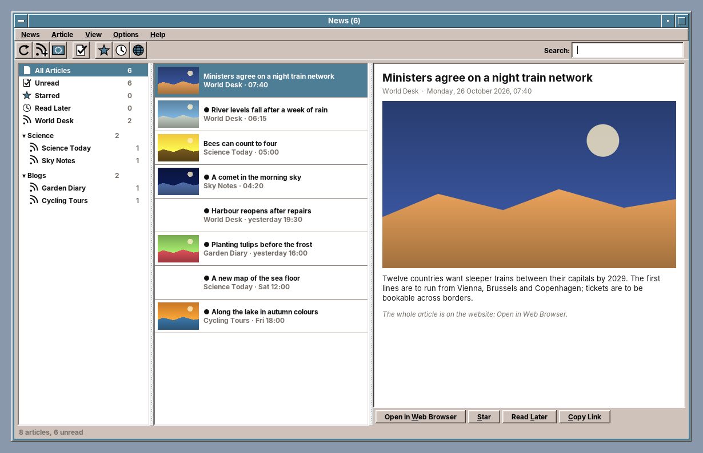

# amade-news

**amade-news** (shown as *News*) is the feed reader of the [amadeOS](https://github.com/datazuul/amadeos) desktop. It fetches the newest articles of websites, blogs and podcasts that offer an RSS or Atom feed and shows them in one list, with pictures and without advertising. *Europe's News* offers the public broadcasters, news agencies and newspapers of European countries to subscribe to by country. Built like the other amadeOS applications.




## Features

- **Three columns**: on the left *All Articles*, *Unread*, *Starred*, *Read Later*, the feeds and their folders with unread counts; in the middle the articles, newest first, with a small picture; on the right the article with its picture and text.
- **Europe's News** (Ctrl+E): countries with their flags and their own names, and per country the feeds to tick. Ticked feeds land in the folder *Europe*, unticked ones are unsubscribed. Feeds in the reader's language and in English come first.
- **Add Feed** (Ctrl+N): a feed address or just the address of a website. The program looks for the feeds the page names and lists them with their number of articles and newest date. A `feed:` link or an address on the command line opens the same dialog.
- **Updating** every 15, 30, 60 or 120 minutes or by hand (F5; Shift+F5 for the selected feed or folder), four feeds at a time. Feeds are asked with *ETag* and *Last-Modified*, so an unchanged feed costs one short answer; a server that asks to wait (429, 503 with *Retry-After*) is left alone for that long. A feed that fails shows why next to its name.
- **Reading**: an article is marked read when shown (can be switched off), *Star* (Ctrl+D) and *Read Later* (Ctrl+L) keep it beyond the keeping time, *Open in Web Browser* (Ctrl+Enter or a double click) shows the whole article. Keys in the lists: `j`/`k` next and previous, `n` or Space next unread, `s` star, `l` read later, `m` read/unread, `o` open.
- **Search** (Ctrl+F) over titles, texts and authors; every word must appear.
- **Folders**: feeds can be renamed and moved; folders renamed from the context menu.
- **OPML** import and export of the subscriptions, to move from or to another feed reader; an `.opml` file on the command line is imported.
- **Preferences**: update interval, update at start, keeping time (7 days to a year), text size and pictures.
- **Network**: the connections follow the proxy of *Settings → Network*, with its password, through `Network.httpClient()` of amade-commons.
- Reads RSS 0.9x/2.0, RSS 1.0 (RDF) and Atom 1.0, with Media RSS, `content:encoded`, Dublin Core and iTunes fields, and repairs common faults (bare `&`, HTML entities, wrong characters, a charset that does not match).
- Five languages (English, Deutsch, Français, Español, Italiano), following the amadeOS desktop language; *Options → Language* overrides it. Articles are shown in the language they were written in.
- Theme colours and Motif look from [amade-commons](https://github.com/datazuul/amade-commons).


## Where the data is

```
~/.config/amadeos/news/
├── subscriptions.opml          the feeds and folders (OPML 2.0)
└── news.properties             preferences
~/.local/share/amadeos/news/articles/
└── 3f2a….json                  the articles of one feed, with read, starred and Read Later
~/.cache/amadeos/news/images/   the pictures, removed after 30 days
```

Files are written as a whole and then moved into place, so a crash never leaves half a file.

## The catalog

`src/main/resources/eu/amadeos/apps/news/catalog/europe.json` lists 47 countries with their own names; 31 of them have feeds so far. Each feed has a title, address, language and kind (public broadcaster, news agency, newspaper, international service). The addresses are not checked by the build yet; a feed that has moved shows its error in the list on the left. Additions are welcome as pull requests.

The flags are from [flag-icons](https://github.com/lipis/flag-icons) 7.6.0 (MIT licence, see `LICENSE-flag-icons.txt` next to them), rendered to PNG.

## Architecture

Java 25, Swing and Guice; start-up, theme and language come from `AmadeApplication` in amade-commons. No libraries besides amade-commons: the feeds are read with the JDK's StAX parser (no DTDs, no external entities) and fetched with `java.net.http.HttpClient`.

| Package | Contents |
|---|---|
| `bootstrap` | `AmadeNewsApplication`, `NewsModule` |
| `domain` | `Feed`, `Article`, `Source` (all, unread, starred, later, folder, one feed), `Settings` |
| `feed` | `FeedParser` (RSS, RDF, Atom), `FeedDiscovery` (feeds named by a web page), `HtmlText`, `Dates` |
| `net` | `Http`, `JdkHttp` |
| `update` | `FeedUpdater` (conditional requests, merging, keeping time), `FeedFinder` (Add Feed) |
| `store` | `Subscriptions`, `Opml`, `ArticleStore`, `FeedState`, `NewsPreferences` |
| `catalog` | `Catalog` (Europe's News) |
| `images` | `ImageCache` (disk and memory) |
| `ui.main` | window, presenter, menus, `ReadingPane`, `NewsGlyph` |
| `ui.dialogs` | `AddFeedDialog`, `CatalogDialog`, `PreferencesDialog` |

The presenter knows the window only through the `MainView` interface, so the tests drive the whole reader (updating, reading, starring, searching, subscribing, the catalog, OPML) with a fake network and without Swing.

## Build and run

```sh
./gradlew run                                         # start
./gradlew run --args="https://example.org/feed.xml"   # start and offer a feed
./gradlew test                                        # Swing tests need a display: xvfb-run ./gradlew test
xvfb-run ./gradlew screenshots                        # docs/screenshots from made-up feeds
./gradlew deb                                         # build/distributions/amade-news_<version>_all.deb
./gradlew installToAmadeOs                            # the .deb into ../amadeos/config/packages.chroot/ for the ISO build
```

If `../amade-commons` is checked out next to this repository, Gradle builds against that checkout instead of the JitPack version.

Platforms: Linux (deb) for now.

## Planned

- *Read full article*: the article's page cleaned up into the reading pane
- Podcasts: episodes handed to amade-audio
- An updated catalog from amadeos.eu without a new release, and a check of its addresses

## License

[EUPL-1.2](LICENSE)
